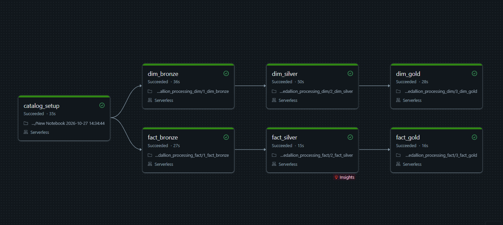

# 🛒 E-Commerce Lakehouse
### Scalable Medallion ETL Pipeline on Databricks (PySpark + Delta Lake + Unity Catalog)


An end-to-end data engineering project that ingests raw retail CSV files, cleans messy data, and publishes a star-schema Gold layer and BI dashboard for e-commerce analytics (~183K order line items).

> **Credit:** Built while following the [codebasics Databricks tutorial](https://youtu.be/761SQ9Hxbic). I added my own SQL queries and dashboard, documented the data cleaning, and created a Databricks Workflow.

---

## 1. Architecture Overview


Catalog: `ecommerce` · Schemas: `bronze`, `silver`, `gold` · Source: Unity Catalog Volume `/Volumes/ecommerce/source_data/raw/`

| Layer | Purpose | Tables |
|---|---|---|
| 🥉 **Bronze** | Raw ingest with explicit schemas + lineage metadata (source file, ingestion timestamp) | 6 `brz_*` tables |
| 🥈 **Silver** | Cleaned, deduplicated, standardized, correctly typed | 6 `slv_*` tables |
| 🥇 **Gold** | Star schema: conformed dimensions + fact with derived measures | 3 dimensions, 1 fact, 1 denormalized fact for BI |

## 2. Tech Stack

| Area | Tools |
|---|---|
| Platform | Databricks, Unity Catalog (catalog → schema → table, Volumes) |
| Processing | Apache Spark, PySpark, Spark SQL |
| Storage | Delta Lake |
| Visualization | Databricks AI/BI Dashboard |
| Version control | Git, GitHub |

## 3. Pipeline Workflow

Notebooks run in this order:

| Step | Notebook | What it does |
|---|---|---|
| 1 | `1_setup/setup_catalog` | Creates the `ecommerce` catalog and `bronze` / `silver` / `gold` schemas |
| 2 | `2_medallion_processing_dim/1_dim_bronze` | Ingests brands, category, products, customers, calendar CSVs |
| 3 | `.../2_dim_silver` | Cleans dimension data |
| 4 | `.../3_dim_gold` | Builds `gld_dim_products`, `gld_dim_customers`, `gld_dim_date` |
| 5 | `3_medallion_processing_fact/1_fact_bronze` | Ingests order items |
| 6 | `.../2_fact_silver` | Cleans order items |
| 7 | `.../3_fact_gold` | Builds `gld_fact_order_items` |

Orchestrated with a Databricks Workflow: 7 tasks with dependencies, running dimension and fact branches in parallel.



### Data quality issues handled in Silver

| Table | Problems fixed |
|---|---|
| `slv_brands` | Whitespace in names, special characters in brand codes, inconsistent category codes (GROCERY→GRCY, BOOKS→BKS, TOYS→TOY) |
| `slv_category` | Duplicate category codes removed, codes uppercased |
| `slv_products` | Units in numeric fields ("g" stripped from weight), comma decimals, misspelled materials (Coton, Alumium, Ruber), negative/null rating counts |
| `slv_customers` | 300 rows with null `customer_id` dropped, missing phones filled |
| `slv_calendar` | String dates parsed (`dd-MM-yyyy`), duplicates removed, quarter/week relabeled |
| `slv_order_items` | Duplicates on (`order_id`, `item_seq`) removed, "Two"→2, `$` and `%` stripped, channel names standardized (web→Website, app→Mobile), mixed timestamp formats unified |

### Gold modeling highlights

- **Star schema:** fact joins to `gld_dim_date` (`date_id`), `gld_dim_products` (`product_id`), `gld_dim_customers` (`customer_id`)
- **Derived measures:** `gross_amount`, `discount_amount`, `net_amount`, and `net_amount_inr` (multi-currency normalized to INR using fixed FX rates)
- **Enrichment:** customer `region` mapping, product category/brand names joined in, `is_weekend` and `date_id` on the date dimension

## 4. Business Insights & Dashboard


| Business question | Query |
|---|---|
| How does revenue trend by month? | `sql/dashboard_queries.sql` (Q1) |
| Which categories sell best? | Q2 |
| How do channels and weekends affect sales? | Q3 |
| Who are the top customers per region? | Q4 |
| Do coupons change discount and order value? | Q5 |

**Headline findings:** 
- **Electronics** is the top category, generating about **₹1.4B** in net revenue
- Sales peaked in **August 2025** at about **₹621.68M**

## 5. Setup & Reproduction

**Prerequisite:** a [Databricks Free Edition](https://www.databricks.com/learn/free-edition) account.

1. Clone: `git clone https://github.com/1rfaan/databricks-medallion-ecommerce.git`
2. In Databricks, **Workspace → Import** the `notebooks/` folders.
3. Upload the CSVs from `datasets/` into a Volume at `/Volumes/ecommerce/source_data/raw/` (one subfolder per dataset; order items go in `order_items/landing/`).
4. Run the notebooks in the order shown in Section 3.
5. Run the queries in `sql/dashboard_queries.sql` or build the dashboard on `gld_fact_order_items`.

## 6. Repository Structure

```
├── notebooks/
│   ├── 1_setup/
│   ├── 2_medallion_processing_dim/
│   └── 3_medallion_processing_fact/
├── datasets/
├── sql/
├── workflows/
└── assets/
```

## 7. Key Learnings

- Defining explicit schemas and keeping risky columns as strings in Bronze, then casting safely in Silver
- Cleaning real-world data anomalies without losing lineage
- Modeling a star schema with derived business measures
- Building a multi-task Databricks Workflow with dependencies
- Cleaning messy real-world data before modeling it

## 8. Author

**Irfan**: BSc Computer Science (Data Analytics), Asia Pacific University
[LinkedIn](https://linkedin.com/in/irfan-muhammed-b565a0313) · [GitHub](https://github.com/1rfaan)
